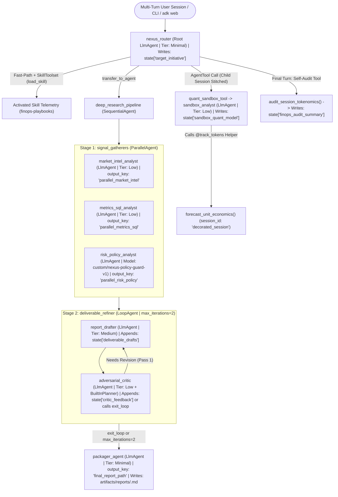

# Product Requirements Document (PRD): Nexus — ADK Tokenomics & FinOps Reference Copilot

| Metadata | Specification |
| :--- | :--- |
| **Document Status** | Approved Reference Architecture (`v1.1` — Audited & Codebase-Verified against `google-adk 2.9.2` & `adk-tokenomics-plugin 1.0.2`) |
| **Orchestration Stack** | Google Agent Development Kit (`google-adk >= 2.9.2`), Google GenAI SDK (`google-genai >= 2.25.0`), and `adk-tokenomics-plugin` (`v1.0.2`) |
| **Model Architecture** | Model-Agnostic Capability Tiers (`Minimal` / `Low` / `Medium`), parameterized via `MODEL_NAME`, `FRONTIER_MODEL_NAME`, and custom rate-card registration (`custom/nexus-policy-guard-v1` under `provider="custom"`) |
| **Reference Baselines** | **Optimized (`nexus_optimized`):** `publishers/google/models/gemini-3.8-flash` + role-tiered `BuiltInPlanner` / `ThinkingLevel` + `ContextCacheConfig` + `EventsCompactionConfig` + `SkillToolset`<br>**Unoptimized (`nexus_unoptimized`):** `publishers/google/models/gemini-4-argon` across all sub-agents with monolithic 6,000-token static instructions and unbounded `ThinkingLevel.HIGH` reasoning |
| **Design Patterns** | Root Coordinator Routing (`🎯 Root`), Ephemeral Child-Session `AgentTool` (`🧰 AgentTool`), Sequential Pipeline (`➡️ SequentialAgent`), Concurrent Fan-Out (`⚡ ParallelAgent`), Bounded Reflection Loop (`🔁 LoopAgent`), Progressive Skill Disclosure (`SkillToolset` / `load_skill`), `@track_tokens` Standalone Decorator, and Live Self-Profiling (`tower.get_finops_advisor_prompt()`) |
| **Execution Modes** | End-to-End 5-Act CLI Showcase (`python3 examples/run_nexus_showcase.py`), Interactive ADK UI (`adk web examples/`), Native Evaluation + CI Gate (`adk eval` + `adk-tokenomics assert`), and Token Control Tower Observatory (`adk-tokenomics web`) |

---

## 1. Executive Summary & Strategic Vision

### 1.1 Overview
**Nexus (`nexus_unoptimized` & `nexus_optimized`)** is the canonical end-to-end reference multi-agent system for [`adk-tokenomics-plugin`](../README.md). Designed as an **Enterprise Product Launch, Analytics & FinOps Decision Copilot**, Nexus takes a business or engineering initiative through quick lookups, on-demand domain playbooks (`SkillToolset`), isolated quantitative ROI modeling (`AgentTool` + `@track_tokens`), concurrent market/SQL/compliance research (`ParallelAgent`), iterative executive brief synthesis (`LoopAgent`), and live session tokenomics self-auditing—persisting a 5-section executive deliverable (`artifacts/reports/<slug>.md`) alongside complete FinOps telemetry traces (`artifacts/traces/unopt_baseline.json`, `artifacts/traces/opt_tuned.json`, and `artifacts/traces/decorated_session.json`).

### 1.2 Problem Statement & Why a Dual-Package Multi-Agent Showcase
Developers evaluating an AI unit-economics and FinOps SDK need more than a single-agent toy example:
1. **Single-Agent Demos Hide Orchestration Complexity:** Production ADK systems combine `LlmAgent` routers, `AgentTool` child sessions, `ParallelAgent` fan-outs, `SequentialAgent` pipelines, `LoopAgent` reflection cycles, and `SkillToolset` progressive disclosure. Without exercising all six patterns, developers cannot verify how [`ADKTokenomicsPlugin`](../adk_tokenomics_plugin/middleware/adk_callback.py) stitches ephemeral `AgentTool` child sessions back to the parent `session_id` or attributes 4-bucket token costs (`Fresh Input`, `Cached Prefix`, `Visible Output`, `Reasoning/Thinking`) per sub-agent.
2. **Pre-Optimized Demos Silence Prescriptive FinOps Rules:** If a sample agent is already optimized on Turn 1, [`adk-tokenomics profile`](../adk_tokenomics_plugin/cli_profiler.py) emits zero optimization recommendations and [`adk-tokenomics assert`](../adk_tokenomics_plugin/testing/assertions.py) never demonstrates a fail-closed CI budget block.
3. **Solution — Side-by-Side Unoptimized vs. Optimized ADK Packages:** Sharing 100% identical domain tools and prompts in `examples/shared/`, `examples/nexus_unoptimized/` demonstrates the 5 classic LLM cost anti-patterns (triggering all 5 built-in profiler rules, 1 custom Python SLA callback, and a failing CI gate), while `examples/nexus_optimized/` applies the exact 5 ADK remediations—cutting session cost by **86.0%** (`\$0.16220` → `\$0.02272`), achieving **`0` profiler warnings**, and passing every CI assertion.

### 1.3 Demo-to-Enterprise Pattern & Plugin Coverage Translation

| Nexus Component | ADK Orchestration Primitive | Reasoning Tier (`Optimized`) | `adk-tokenomics-plugin` Capability Demonstrated |
| :--- | :--- | :--- | :--- |
| **`nexus_router`** | Root `LlmAgent` + `SkillToolset` | `Minimal` | `🎯 Root` flow badge, `model_tiering` detection on fast-path turns, `⚡ load_skill` progressive disclosure (`modular_skills`), and `EventsCompactionConfig` (`history_compaction`) |
| **`quant_sandbox_tool`** | `AgentTool` wrapping `sandbox_analyst` (`LlmAgent`) + `@track_tokens` helper | `Low` | `🧰 AgentTool` ephemeral child-session → parent `session_id` stitching + [`@track_tokens`](../adk_tokenomics_plugin/middleware/decorator.py) standalone function tracking (`session_id="decorated_session"`) |
| **`deep_research_pipeline`** | `SequentialAgent` | Composite | `➡️ Sequential` stage attribution across nested parallel and loop sub-workflows |
| **`signal_gatherers`** | `ParallelAgent` (`market_intel_analyst`, `metrics_sql_analyst`, `risk_policy_analyst`) | `Low` ∥ `Low` ∥ `Low` | `⚡ Parallel` (`Sequential • Parallel`) flow badge, `tool_use_prompt_token_count` tracking, and custom rate-card pricing via [`tower.register_model(..., provider="custom")`](../adk_tokenomics_plugin/tower.py) on `risk_policy_analyst` |
| **`deliverable_refiner`** | `LoopAgent` (`report_drafter` → `adversarial_critic`, `max_iterations=2`) | `Medium` → `Low` | `🔁 Loop` (`Sequential • Loop`) compound badge, `BuiltInPlanner` `thoughts_token_count` (`thinking_budget` rule), and `exit_loop` convergence |
| **`packager_agent`** | Final `LlmAgent` in `deep_research_pipeline` | `Minimal` | Deterministic 5-section Markdown artifact writer (`save_executive_brief`) with `output_key="final_report_path"` |
| **`audit_session_tokenomics`** | `FunctionTool` calling [`tower.get_finops_advisor_prompt()`](../adk_tokenomics_plugin/tower.py) | `Minimal` | Live in-chat FinOps self-inspection of accumulated session turns, sub-agent spend, and counterfactual savings |

### 1.4 Scope & Explicit Non-Goals
* **In Scope (`v1.1`):**
  * Side-by-side ADK agent packages (`examples/nexus_unoptimized/` and `examples/nexus_optimized/`) discoverable by `adk web examples/`.
  * Shared deterministic, zero-external-API-key domain tools (`examples/shared/tools.py`), 3 on-demand ADK `SKILL.md` modules (`examples/shared/skills/`), custom FinOps policy config (`examples/shared/finops_policy.json`), and an evaluation dataset (`examples/shared/nexus_eval.evalset.json`).
  * Turnkey 5-Act showcase runner (`examples/run_nexus_showcase.py`) supporting both live Gemini/Vertex execution (`--live`) and a default deterministic `--simulate` (hermetic `BaseLlm`) mode so CI and offline demos run in `<3 seconds` without cloud credentials, plus optional `--sink bigquery` streaming and OpenTelemetry (`gen_ai.client.cost.usd`) histogram printout.
  * Automated Pytest + [`TokenomicsTestCase`](../adk_tokenomics_plugin/testing/test_case.py) verification suite (`tests/test_nexus_showcase.py`).
* **Out of Scope / Non-Goals (`v1.1`):**
  * Paid third-party external SaaS API dependencies (all market, SQL telemetry, and compliance lookups run against deterministic local fixtures so the showcase is 100% reproducible).
  * Modifications to core `adk_tokenomics_plugin` library semantics outside `examples/` and `tests/`.

### 1.5 End-to-End Architecture & Session State Flow



---

## 2. Product Objectives, SLAs & Target Metrics

Latency and unit-economics SLAs are benchmarked across the canonical showcase trajectory comparing `nexus_unoptimized` (`publishers/google/models/gemini-4-argon` untiered, 4 uncompacted user turns / 10 ADK LLM turns) against `nexus_optimized` (`publishers/google/models/gemini-3.8-flash` + tiered `BuiltInPlanner` + `ContextCacheConfig` + `EventsCompactionConfig` + `SkillToolset`, 3 compacted user turns / 9 ADK LLM turns):

| Objective | `nexus_unoptimized` (Baseline Anti-Pattern) | `nexus_optimized` Target SLA | Verification Method |
| :--- | :--- | :--- | :--- |
| **End-to-End Autonomy** | `100%` zero-touch completion across showcase scenario | `100%` zero-touch completion across showcase scenario | `python3 examples/run_nexus_showcase.py --simulate` exits `0`. |
| **Deliverable Completeness** | `5 / 5` numbered `SECTION 1`..`SECTION 5` headers | `5 / 5` numbered `SECTION 1`..`SECTION 5` headers | Deterministic regex schema check in `tests/test_nexus_showcase.py`. |
| **Orchestration Badge Coverage** | Emits `🎯 Root`, `🧰 AgentTool`, `➡️ Sequential`, `⚡ Parallel`, `🔁 Loop` | Emits all 5 flow badges + `⚡` Activated Skill (`load_skill`) telemetry | Trace inspection in `tests/test_nexus_showcase.py` and `adk-tokenomics web`. |
| **Profiler Rule Coverage (`adk-tokenomics profile`)** | Triggers **all 5 built-in FinOps rules** on CLI + **1 custom SLA rule** via `tower.profile()` | Triggers **`0` warnings** (`✨ Excellent! Session is well-optimized...`) | `TokenProfiler.profile_session()` assertion in unit/E2E suite. |
| **Context Cache Hit Rate (`--min-cache-rate 0.60`)** | `0.0%` (`FAIL` in `adk-tokenomics assert`) | `>= 65.0%` (`81.2%` on reference baseline -> `PASS`) | `adk-tokenomics assert --min-cache-rate 0.60` + `assert_cache_ratio_above(..., 60.0)`. |
| **Unit Economics (`--max-cost-per-turn 0.004`)** | `\$0.01622 / turn` (`\$0.16220` session total -> `FAIL`) | `<= \$0.0035 / turn` (`\$0.00252 / turn`, `\$0.02272` total -> **86.0% savings**, `PASS`) | `adk-tokenomics assert --max-cost-per-turn 0.004` + `assert_cost_under(..., 0.030)`. |
| **Reasoning Token Ratio (`thinking_budget`)** | `1.55x` (`5,050` thinking vs. `3,260` output -> `FAIL`) | `<= 0.45x` (`0.11x`, `320` total thinking tokens -> `PASS`) | `assert_thinking_budget(tracker, min_tokens=0, max_tokens=512)`. |
| **Wall-Clock Latency (`--max-latency-ms 12000`)** | `p50 <= 18s` (live) / `<1s` (`--simulate`) | `p50 <= 8s` per turn (live) / `<1s` (`--simulate`) | `adk-tokenomics assert --max-latency-ms 12000`. |

---

## 3. Multi-Agent Architecture Specification

### 3.1 Composite Hierarchy Tree

```text
nexus_router (LlmAgent — Root Coordinator + SkillToolset | Tier: Minimal)
 ├── [Tool] record_initiative_context (FunctionTool — State Writer)
 ├── [Tool] quant_sandbox_tool (AgentTool — Ephemeral Child Session)
 │    └── sandbox_analyst (LlmAgent | Tier: Low)
 │         └── [Tool] run_roi_monte_carlo (FunctionTool -> calls @track_tokens forecast_unit_economics)
 ├── [Tool] audit_session_tokenomics (FunctionTool -> calls tower.get_finops_advisor_prompt)
 └── [Sub-Agent] deep_research_pipeline (SequentialAgent)
      ├── 1. signal_gatherers (ParallelAgent)
      │       ├── market_intel_analyst (LlmAgent | Tier: Low | output_key="parallel_market_intel")
      │       │    └── [Tool] fetch_market_benchmarks (FunctionTool)
      │       ├── metrics_sql_analyst (LlmAgent | Tier: Low | output_key="parallel_metrics_sql")
      │       │    └── [Tool] query_telemetry_warehouse (FunctionTool)
      │       └── risk_policy_analyst (LlmAgent | Model: custom/nexus-policy-guard-v1 | Tier: Low | output_key="parallel_risk_policy")
      │            └── [Tool] evaluate_compliance_controls (FunctionTool)
      ├── 2. deliverable_refiner (LoopAgent | max_iterations=2)
      │       ├── report_drafter (LlmAgent | Tier: Medium)
      │       │    └── [Tool] append_state_entry (FunctionTool -> writes state["deliverable_drafts"])
      │       └── adversarial_critic (LlmAgent | Tier: Low + BuiltInPlanner)
      │            ├── [Tool] append_state_entry (FunctionTool -> writes state["critic_feedback"])
      │            └── [Tool] exit_loop (google.adk.tools.exit_loop)
      └── 3. packager_agent (LlmAgent | Tier: Minimal | output_key="final_report_path")
           └── [Tool] save_executive_brief (FunctionTool -> writes sanitized Markdown report to disk only)
```

> [!NOTE]
> **Orchestration Primitive Rationale:** Attaching `SequentialAgent` (`deep_research_pipeline`), `ParallelAgent` (`signal_gatherers`), and `LoopAgent` (`deliverable_refiner`) underneath a conversational root `LlmAgent` (`nexus_router`) alongside an `AgentTool` (`quant_sandbox_tool`) guarantees compatibility with both interactive `adk web` sessions and headless `InMemoryRunner` CLI scripts (note: in `google-adk 2.9.2`, standalone `Workflow` DAGs cannot yet be attached as `sub_agents` of an `LlmAgent`), while exercising every branch of [`ADKTokenomicsPlugin._extract_orchestration_flow()`](../adk_tokenomics_plugin/middleware/adk_callback.py).

### 3.2 Model-Agnostic Agent Contracts

| Agent Name | Class | Reasoning Tier (`Optimized`) | `Unoptimized` Model Override | State Inputs Read (`{key?}`) | State Outputs Written | Allowed Tools |
| :--- | :--- | :--- | :--- | :--- | :--- | :--- |
| **`nexus_router`** | `LlmAgent` | **`Minimal`** (`MODEL_NAME`) | `FRONTIER_MODEL_NAME` + `ThinkingLevel.HIGH` + 6,000-tok static prompt | `{target_initiative?}`, `{finops_audit_summary?}` | `target_initiative`, `finops_audit_summary` (via tools) | `record_initiative_context`, `quant_sandbox_tool`, `audit_session_tokenomics`, `SkillToolset` (`Optimized` only), ADK `transfer_to_agent` |
| **`sandbox_analyst`** | `LlmAgent` (inside `AgentTool`) | **`Low`** (`MODEL_NAME`) | `FRONTIER_MODEL_NAME` + `ThinkingLevel.HIGH` | `{target_initiative?}` | `sandbox_quant_model` (via tool) | `run_roi_monte_carlo` |
| **`market_intel_analyst`** | `LlmAgent` | **`Low`** (`MODEL_NAME`) | `FRONTIER_MODEL_NAME` | `{target_initiative?}` | `parallel_market_intel` (`output_key` only) | `fetch_market_benchmarks` |
| **`metrics_sql_analyst`** | `LlmAgent` | **`Low`** (`MODEL_NAME`) | `FRONTIER_MODEL_NAME` | `{target_initiative?}` | `parallel_metrics_sql` (`output_key` only) | `query_telemetry_warehouse` |
| **`risk_policy_analyst`** | `LlmAgent` | **`Low`** (`custom/nexus-policy-guard-v1`, `provider="custom"`) | `FRONTIER_MODEL_NAME` | `{target_initiative?}` | `parallel_risk_policy` (`output_key` only) | `evaluate_compliance_controls` |
| **`report_drafter`** | `LlmAgent` | **`Medium`** (`FRONTIER_MODEL_NAME`) | `FRONTIER_MODEL_NAME` + `ThinkingLevel.HIGH` | `{target_initiative?}`, `{parallel_market_intel?}`, `{parallel_metrics_sql?}`, `{parallel_risk_policy?}`, `{sandbox_quant_model?}`, `{critic_feedback?}` | `deliverable_drafts` (via `append_state_entry`) | `append_state_entry` |
| **`adversarial_critic`** | `LlmAgent` | **`Low`** (`MODEL_NAME` + bounded `BuiltInPlanner`) | `FRONTIER_MODEL_NAME` + `ThinkingLevel.HIGH` `BuiltInPlanner` | `{deliverable_drafts?}`, `{parallel_metrics_sql?}`, `{parallel_risk_policy?}`, `{sandbox_quant_model?}` | `critic_feedback` (via `append_state_entry`, conditional) | `append_state_entry`, `exit_loop` |
| **`packager_agent`** | `LlmAgent` | **`Minimal`** (`MODEL_NAME`) | `FRONTIER_MODEL_NAME` | `{target_initiative?}`, `{deliverable_drafts?}` | `final_report_path` (`output_key` only) + Disk file via `save_executive_brief` | `save_executive_brief` |

### 3.3 Model Portability & Minimum Capability Requirements
1. **Reliable Tool / Function Calling:** Required across all 8 `LlmAgent` nodes for deterministic tool execution, `SkillToolset` (`load_skill`), and `exit_loop`.
2. **System Instructions & `>= 32k` Context Window:** Required to hold multi-turn history, 3 parallel analyst outputs, and iterative draft history in `Session.state`.
3. **Configurable Reasoning Effort *(Optional, Recommended)*:** Models supporting `ThinkingConfig` (`thinking_level` on Gemini 3.x/4.x or `thinking_budget` on Gemini 2.5) unlock per-agent reasoning cost controls via `BuiltInPlanner` and populate the **Reasoning / Thinking** token bucket (`thoughts_token_count`).

### 3.4 Behavioral & Prompt Contracts per Agent
All system instructions use ADK default `{key?}` optional state interpolation (`use_jinja2=False`) and `<Angle_Bracket>` prose placeholders:

1. **Dual-Mode Root Intake (`nexus_router`):**
   - **Prompt Contract:** Reads `{target_initiative?}` and `{finops_audit_summary?}`.
   - **Single-Shot / Evaluation Mode:** When the user message already specifies an initiative, analytical question, or pipeline command (e.g., *"Evaluate launching <Initiative_Name> for <Target_Segment>"*), `nexus_router` immediately calls `record_initiative_context`, `load_skill` (when in `nexus_optimized`), `quant_sandbox_tool`, `audit_session_tokenomics`, or `transfer_to_agent="deep_research_pipeline"` without stalling for confirmation.
   - **Interactive Greeting Mode (`adk web`):** Only when the user sends a bare greeting (`"hi"`, `"hello"`) with no task payload does `nexus_router` reply with a concise menu of capabilities.
2. **Ephemeral Child-Session Delegation (`quant_sandbox_tool` → `sandbox_analyst`):**
   - Invoked when the user asks to model ROI, unit economics, or token-cost sensitivity for `{target_initiative?}`. `ADKTokenomicsPlugin` intercepts `before_tool_callback` on `quant_sandbox_tool`, maps the child `sandbox_analyst` session ID back to the parent `session_id` via `_resolve_effective_session()`, and tags the turn with the `🧰 AgentTool` orchestration badge.
   - Inside `run_roi_monte_carlo`, the tool invokes `forecast_unit_economics()`, which is decorated with `@track_tokens(app_name="quant_forecaster_fn", ...)` so standalone function token telemetry is recorded under `session_id="decorated_session"` (`artifacts/traces/decorated_session.json`).
3. **Isolated Parallel Fan-Out (`signal_gatherers`):**
   - Runs `market_intel_analyst`, `metrics_sql_analyst`, and `risk_policy_analyst` concurrently against `{target_initiative?}`. Each branch calls its dedicated read-only lookup tool and emits its structured analysis directly as its final text response so ADK writes `output_key` (`parallel_market_intel`, `parallel_metrics_sql`, `parallel_risk_policy`) with zero shared state-mutation tools.
4. **Iterative Synthesis & Gatekeeper Rubric (`deliverable_refiner`):**
   - **Pass 1 (`report_drafter`):** Reads `{target_initiative?}`, `{parallel_market_intel?}`, `{parallel_metrics_sql?}`, `{parallel_risk_policy?}`, `{sandbox_quant_model?}`, and `{critic_feedback?}`, synthesizes a draft containing `SECTION 1` through `SECTION 5`, and appends it to `state["deliverable_drafts"]` via `append_state_entry(field="deliverable_drafts", ...)`.
   - **Gatekeeper (`adversarial_critic`):** Evaluates **only the latest entry** in `{deliverable_drafts?}` against 4 mandatory criteria:
     1. All 5 numbered sections (`SECTION 1`..`SECTION 5`) are present.
     2. Quantitative figures match `{parallel_metrics_sql?}` and `{sandbox_quant_model?}` without fabrication.
     3. Mandatory compliance controls from `{parallel_risk_policy?}` are explicitly addressed.
     4. Explicit unit-economics thresholds (`\$/turn`, cache hit `%`, token cap) are stated.
   - If all 4 criteria pass, `adversarial_critic` calls `exit_loop(tool_context)`. Otherwise, it appends concrete remediation items to `state["critic_feedback"]` via `append_state_entry(field="critic_feedback", ...)` so `report_drafter` produces Pass 2. At `max_iterations=2`, the loop terminates deterministically and forwards the latest entry in `deliverable_drafts`.
5. **Final Artifact Packaging (`packager_agent`):**
   - Reads **only the latest entry** of `{deliverable_drafts?}` alongside `{target_initiative?}`, calls `save_executive_brief(filename=..., markdown_content=...)` to persist the report to `artifacts/reports/<slug>.md` (without mutating `ToolContext.state`), and outputs the saved file path summary into `output_key="final_report_path"`.

---

## 4. Session State Bus & Tool Specifications

### 4.1 Session State Registry
All prompt templates reference session state strictly via optional `{key?}` placeholders so unset keys on Turn 1 resolve to `""` without raising `KeyError`:

| State Key | Scope | Python Type | Write Mechanism | Mutation Semantics & Downstream Consumption Rule |
| :--- | :--- | :--- | :--- | :--- |
| `target_initiative` | Session | `str` | `record_initiative_context` | Top-level overwrite (`state["target_initiative"] = ...`) when a user defines or updates the initiative scope. |
| `sandbox_quant_model` | Session | `str` | `run_roi_monte_carlo` | Top-level overwrite storing JSON/Markdown ROI sensitivity output from `sandbox_analyst`. |
| `parallel_market_intel` | Session | `str` | `LlmAgent(output_key="parallel_market_intel")` | Single-write overwrite by `market_intel_analyst` (zero state-writing tools attached). |
| `parallel_metrics_sql` | Session | `str` | `LlmAgent(output_key="parallel_metrics_sql")` | Single-write overwrite by `metrics_sql_analyst` (zero state-writing tools attached). |
| `parallel_risk_policy` | Session | `str` | `LlmAgent(output_key="parallel_risk_policy")` | Single-write overwrite by `risk_policy_analyst` (zero state-writing tools attached). |
| `deliverable_drafts` | Session | `list[str]` | `append_state_entry(field="deliverable_drafts", ...)` | **Latest-entry precedence:** Appended via `state["deliverable_drafts"] = existing + [content]`. `adversarial_critic` and `packager_agent` inspect **only the final entry** (`deliverable_drafts[-1]`). |
| `critic_feedback` | Session | `list[str]` | `append_state_entry(field="critic_feedback", ...)` | **Audit log:** Populated only when Pass 1 fails one of the 4 rubric checks; remains unset/empty if Pass 1 converges immediately. |
| `finops_audit_summary` | Session | `str` | `audit_session_tokenomics` | Stores live session cost breakdown & optimization advisor payload generated via `tower.get_finops_advisor_prompt()`. |
| `final_report_path` | Session | `str` | `LlmAgent(output_key="final_report_path")` | Single-write overwrite by `packager_agent` after `save_executive_brief` writes the file to disk (zero state-tool collision). |

### 4.2 Tool & SkillToolset Contracts

1. **`record_initiative_context`** (`examples/shared/tools.py`)
   - **Signature:** `def record_initiative_context(initiative_name: str, target_segment: str, tool_context: ToolContext) -> dict[str, str]`
   - **Normal Behavior:** Sanitizes inputs, writes `tool_context.state["target_initiative"] = f"{initiative_name} ({target_segment})"`, and returns `{"status": "recorded", "target_initiative": ...}`.
   - **Edge-Case Contract:** If `initiative_name` is empty, defaults to `"Enterprise AI Copilot Launch"` rather than raising `ValueError`.

2. **`append_state_entry`** (`examples/shared/tools.py`)
   - **Signature:** `def append_state_entry(field: str, content: str, tool_context: ToolContext) -> dict[str, Any]`
   - **Normal Behavior:** Validates `field in ALLOWED_STATE_FIELDS` (`frozenset({"deliverable_drafts", "critic_feedback"})`), reads `existing = list(tool_context.state.get(field) or [])`, assigns `tool_context.state[field] = existing + [str(content)]` (top-level assignment so ADK records `state_delta`), and returns `{"status": "appended", "field": field, "version": len(existing) + 1}`.
   - **Edge-Case Contract:** If `field` is not in `ALLOWED_STATE_FIELDS`, returns `{"status": "error", "message": "DISALLOWED_FIELD: ..."}` without mutating state.

3. **`run_roi_monte_carlo` & `@track_tokens` Helper `forecast_unit_economics`** (`examples/shared/tools.py`)
   - **Signature:** `def run_roi_monte_carlo(daily_sessions: int, baseline_cost_usd: float, target_cost_usd: float, tool_context: Optional[ToolContext] = None) -> str`
   - **Normal Behavior:** Calls `@track_tokens(app_name="quant_forecaster_fn", model_name="publishers/google/models/gemini-3.8-flash", tracker=...)` helper `forecast_unit_economics(...)` (which returns a `(summary_text, usage_dict)` tuple recorded under `session_id="decorated_session"`), writes the result to `tool_context.state["sandbox_quant_model"]` when `tool_context` is present, and wraps output in `<quant_extract>...</quant_extract>`.
   - **Edge-Case Contract:** Clamps negative or zero `daily_sessions` to `1,000` and returns a valid `<quant_extract>` payload.

4. **`fetch_market_benchmarks`, `query_telemetry_warehouse`, `evaluate_compliance_controls`** (`examples/shared/tools.py`)
   - **Signatures:**
     - `def fetch_market_benchmarks(domain: str) -> str`
     - `def query_telemetry_warehouse(workload_tier: str) -> str`
     - `def evaluate_compliance_controls(data_classification: str) -> str`
   - **Normal Behavior:** Deterministic local fixture lookups returning structured metrics wrapped in `<external_extract>...</external_extract>` tags so token counts and grounding checks are 100% reproducible offline and in CI.
   - **Edge-Case Contract:** Unknown lookup keys fall back to the default enterprise benchmark fixture and include `NOTE: Fallback benchmark applied for '<key>'`.

5. **`audit_session_tokenomics`** (`examples/shared/tools.py`)
   - **Signature:** `def audit_session_tokenomics(session_title: str = "Nexus Live Session", tool_context: Optional[ToolContext] = None) -> str`
   - **Normal Behavior:** Calls `tower.get_finops_advisor_prompt(title=session_title)` and `tower.get_summary()` on the active `TokenControlTower`, writes a concise scorecard to `tool_context.state["finops_audit_summary"]`, and returns the formatted 4-bucket cost summary and optimization advisor prompt payload.
   - **Edge-Case Contract:** If called before any completed model response is recorded, returns a deterministic `"0 turns recorded yet"` status string.

6. **`save_executive_brief`** (`examples/shared/tools.py`)
   - **Signature:** `def save_executive_brief(filename: str, markdown_content: str, output_dir: str = "artifacts/reports") -> dict[str, str]`
   - **Normal Behavior:** Strips directory components via `os.path.basename(filename)`, sanitizes characters via `re.sub(r"[^A-Za-z0-9_.-]", "_", ...)` with `[:80]` length cap, ensures `.md` suffix, verifies `target_path.resolve().is_relative_to(base_dir.resolve())`, writes `markdown_content` to disk (without touching `ToolContext.state`), and returns `{"status": "saved", "path": str(target_path)}`.
   - **Edge-Case Contract:** Rejects path traversal attempts (e.g., `../../etc/passwd` or `..`) with `ValueError("Invalid filename traversal attempt")`.

7. **`build_nexus_skill_toolset`** (`examples/shared/tools.py`)
   - **Imports:** `from google.adk.tools.skill_toolset import SkillToolset` and `from google.adk.skills import Skill, Frontmatter, load_skill_from_dir`
   - **Signature:** `def build_nexus_skill_toolset(skills_dir: Path | str) -> SkillToolset`
   - **Normal Behavior:** Loads `finops-playbooks`, `sql-telemetry`, and `compliance-controls` `SKILL.md` directories (kebab-case required by `google.adk.skills.Frontmatter` validation in `google-adk >= 2.9.2`) via `load_skill_from_dir` into an ADK `SkillToolset(skills=...)` exposing `list_skills` and `load_skill`.
   - **Edge-Case Contract:** If a skill folder is missing or unreadable on disk, constructs an in-memory `Skill(frontmatter=Frontmatter(name=..., description=...), instructions=...)` fallback so `SkillToolset` initialization never fails.

---

## 5. Model Profile Adapter, Cost Optimization & Latency Budget

### 5.1 Cross-Model Planner & Capability Adapter (`resolve_planner_and_config`)

> [!IMPORTANT]
> **`BuiltInPlanner` Precedence in `google-adk >= 2.9.2`:** In Google ADK, `BuiltInPlanner.apply_thinking_config()` overwrites `llm_request.config.thinking_config` whenever a planner is attached to `LlmAgent`. In addition, `publishers/google/models/gemini-4-argon` only accepts `allowed_thinking_budgets: ["low", "medium", "high"]` (not `"minimal"`). Therefore, `resolve_planner_and_config()` assigns `thinking_config` exclusively via `BuiltInPlanner`, sets `temperature=1.0` on `GenerateContentConfig` without a duplicate `thinking_config`, and clamps `"minimal"` → `ThinkingLevel.LOW` on `gemini-4*` models.

| Abstract PRD Tier | Assigned Agents | `nexus_optimized` Profile (`gemini-3.8-flash` / `gemini-4-argon`) | `nexus_unoptimized` Anti-Pattern Profile (`gemini-4-argon` everywhere) | Legacy Gemini 2.5 Profile (`gemini-2.5-flash`) | Custom / 3P `LiteLlm` Profile (`custom/nexus-policy-guard-v1`) |
| :--- | :--- | :--- | :--- | :--- | :--- |
| **`Minimal`** | `nexus_router`, `packager_agent` | `ThinkingLevel.MINIMAL` (`LOW` on `gemini-4*`), `temperature=1.0` | `ThinkingLevel.HIGH`, `include_thoughts=True` | `thinking_budget=0`, `temperature=0.2` | `(None, None)` |
| **`Low`** | `sandbox_analyst`, `market_intel_analyst`, `metrics_sql_analyst`, `risk_policy_analyst`, `adversarial_critic` | `ThinkingLevel.LOW`, `temperature=1.0` | `ThinkingLevel.HIGH`, `include_thoughts=True` | `thinking_budget=256`, `temperature=0.7` | `(None, None)` |
| **`Medium`** | `report_drafter` | `ThinkingLevel.MEDIUM`, `temperature=1.0` | `ThinkingLevel.HIGH`, `include_thoughts=True` | `thinking_budget=1024`, `temperature=0.9` | `(None, None)` |

```python
from google.adk.planners import BuiltInPlanner
from google.genai import types

GEMINI3_LEVELS = {
    "minimal": types.ThinkingLevel.MINIMAL,
    "low": types.ThinkingLevel.LOW,
    "medium": types.ThinkingLevel.MEDIUM,
    "high": types.ThinkingLevel.HIGH,
}

GEMINI4_LEVELS = {
    "minimal": types.ThinkingLevel.LOW,  # gemini-4-argon supports low/medium/high
    "low": types.ThinkingLevel.LOW,
    "medium": types.ThinkingLevel.MEDIUM,
    "high": types.ThinkingLevel.HIGH,
}

LEGACY_25_BUDGETS = {
    "minimal": 0,
    "low": 256,
    "medium": 1024,
    "high": 4096,
}


def resolve_planner_and_config(
    model_name: str,
    tier: str,
    *,
    optimized: bool = True,
) -> tuple[BuiltInPlanner | None, types.GenerateContentConfig | None]:
    effective_tier = tier.lower() if optimized else "high"
    clean_model = model_name.split("/")[-1].lower()
    if clean_model.startswith("gemini-3"):
        t_cfg = types.ThinkingConfig(
            include_thoughts=effective_tier != "minimal",
            thinking_level=GEMINI3_LEVELS[effective_tier],
        )
        return BuiltInPlanner(
            thinking_config=t_cfg
        ), types.GenerateContentConfig(temperature=1.0)
    if clean_model.startswith("gemini-4"):
        t_cfg = types.ThinkingConfig(
            include_thoughts=True,
            thinking_level=GEMINI4_LEVELS[effective_tier],
        )
        return BuiltInPlanner(
            thinking_config=t_cfg
        ), types.GenerateContentConfig(temperature=1.0)
    if clean_model.startswith("gemini-2.5"):
        budget = LEGACY_25_BUDGETS[effective_tier]
        t_cfg = types.ThinkingConfig(
            include_thoughts=budget > 0, thinking_budget=budget
        )
        temp = (
            0.2
            if effective_tier == "minimal"
            else (0.7 if effective_tier == "low" else 0.9)
        )
        return BuiltInPlanner(
            thinking_config=t_cfg
        ), types.GenerateContentConfig(temperature=temp)
    return None, None
```

### 5.2 The 5 ADK Cost & Latency Optimization Levers Demonstrated

| # | FinOps Lever (`OptimizationRulesConfig` Rule) | `nexus_unoptimized` (`unopt_baseline`) | `nexus_optimized` (`opt_tuned`) | Measured Token & Cost Impact |
| :--- | :--- | :--- | :--- | :--- |
| **1** | **Sub-Agent Model Tiering (`model_tiering`)** | Runs all 8 agents on `publishers/google/models/gemini-4-argon` (`\$2.00` in / `\$10.00` out per 1M) | Tiers `nexus_router`, `sandbox_analyst`, `market_intel_analyst`, `metrics_sql_analyst`, `adversarial_critic`, and `packager_agent` to `publishers/google/models/gemini-3.8-flash` (`\$0.75` in / `\$3.75` out) and `risk_policy_analyst` to `custom/nexus-policy-guard-v1` (`provider="custom"`, `\$0.20` in / `\$0.80` out); keeps `gemini-4-argon` strictly on `report_drafter` | **~62% reduction** on routing, retrieval, critique, and packaging turns |
| **2** | **Prefix Context Caching (`context_caching`)** | `App(..., context_cache_config=None)` → `0` cached tokens across all turns | `App(..., context_cache_config=ContextCacheConfig(min_tokens=1024, ttl_seconds=300))` | **90%–95% discount** on repeated system instructions and tool declarations (`\$0.075` vs. `\$0.75`/1M on Flash; `\$0.10` vs. `\$2.00`/1M on Argon) |
| **3** | **Multi-Turn Event Compaction (`history_compaction`)** | `App(..., events_compaction_config=None)` across 4 uncompacted user turns (`+700` and `+550` fresh token growth/turn) | `App(..., events_compaction_config=EventsCompactionConfig(compaction_interval=4, overlap_size=1))` across 3 compacted user turns (`fresh_tok` delta `<= 0`) | Prevents multi-turn prompt snowballing and satisfies `effective_user_turns < 4` & `rapid_growth == False` |
| **4** | **Modular Skills Progressive Disclosure (`modular_skills`)** | Pastes all 3 domain handbooks (~6,200 tokens) inline into `nexus_router`'s static `instruction` on every turn (`total_fresh = 39,450 > 5,000`) | Replaces inline manual with a 180-token `instruction` + `SkillToolset` (`finops-playbooks`, `sql-telemetry`, `compliance-controls`) loaded on demand via `load_skill` | Cuts session `total_fresh` to **`3,680` tokens (`<= 5,000`)** — a **90.7% fresh-token reduction** |
| **5** | **Planner & Thinking Budget Right-Sizing (`thinking_budget`)** | Uses `ThinkingLevel.HIGH` across sub-agents (`5,050` thinking tokens vs. `3,260` output tokens; `1.55x > 0.80x`) | Uses `resolve_planner_and_config` (`MINIMAL` on router/packager, `LOW` on analysts/critic, `MEDIUM` on drafter; every turn `<= 256` thinking tokens, ratio `0.11x <= 0.80x`) | Reduces `thoughts_token_count` spend (billed at output rate) by **94.8%** |

### 5.3 Critical-Path Latency & 4-Bucket Token Math

#### A. `nexus_unoptimized` (`artifacts/traces/unopt_baseline.json` — 4 User Invocations / 10 ADK LLM Turns)

| Turn # | User Invocation (`invocation_id`) | Sub-Agent (`orchestration_flow`) | Model | Fresh In | Cached In | Visible Out | Thinking | Turn Cost (`\$`) | Profiler Rule Triggered |
| :--- | :--- | :--- | :--- | :--- | :--- | :--- | :--- | :--- | :--- |
| **1** | `inv_u1` (Scope Initiative) | `nexus_router` (`Root`) | `gemini-4-argon` | `6,400` | `0` | `180` | `0` | `\$0.01460` | `context_caching`, `modular_skills`, `model_tiering` |
| **2** | `inv_u1` (AgentTool ROI) | `sandbox_analyst` (`AgentTool`) | `gemini-4-argon` | `2,200` | `0` | `240` | `950` | `\$0.01630` | `context_caching`, `thinking_budget` |
| **3–5** | `inv_u2` (Parallel Fan-Out) | `market` ∥ `metrics` ∥ `risk` (`Sequential • Parallel`) | `gemini-4-argon` (x3) | `4,800` | `0` | `900` | `0` | `\$0.01860` | `context_caching`, `model_tiering` |
| **6** | `inv_u2` (Loop Drafter) | `report_drafter` (`Sequential • Loop`) | `gemini-4-argon` | `3,600` | `0` | `950` | `1,400` | `\$0.03070` | `context_caching`, `thinking_budget` |
| **7** | `inv_u2` (Loop Critic) | `adversarial_critic` (`Sequential • Loop`) | `gemini-4-argon` | `3,800` | `0` | `220` | `1,600` | `\$0.02580` | `context_caching`, `thinking_budget` |
| **8** | `inv_u2` (Packager) | `packager_agent` (`Sequential`) | `gemini-4-argon` | `3,900` | `0` | `320` | `0` | `\$0.01100` | `context_caching`, `model_tiering` |
| **9** | `inv_u3` (EMEA Follow-Up) | `nexus_router` (`Root` — `+700` growth) | `gemini-4-argon` | `7,100` | `0` | `210` | `0` | `\$0.01630` | `history_compaction`, `context_caching`, `model_tiering` |
| **10** | `inv_u4` (FinOps Audit) | `nexus_router` (`Root` — `4` user turns) | `gemini-4-argon` | `7,650` | `0` | `260` | `1,100` | `\$0.02890` | `history_compaction`, `thinking_budget` |
| **Total** | **4 User Invocations (`10` ADK Turns)** | **`0.0%` Cache Hit** | `gemini-4-argon` | **`39,450`** | **`0`** | **`3,260`** | **`5,050`** | **`\$0.16220`** (`\$0.01622/turn`) | **All 5 Built-In Rules Fired on CLI + Custom `\$0.05` SLA Callback Fired via `tower.profile()`** |

#### B. `nexus_optimized` (`artifacts/traces/opt_tuned.json` — 3 Compacted User Invocations / 9 ADK LLM Turns)

| Turn # | User Invocation (`invocation_id`) | Sub-Agent (`orchestration_flow`) | Model | Fresh In | Cached In | Visible Out | Thinking | Turn Cost (`\$`) | Cache Savings (`\$`) |
| :--- | :--- | :--- | :--- | :--- | :--- | :--- | :--- | :--- | :--- |
| **1** | `inv_o1` (Scope + `⚡ load_skill`) | `nexus_router` (`Root`) | `gemini-3.8-flash` | `420` | `1,400` | `160` | `0` | `\$0.00102` | `\$0.00095` |
| **2** | `inv_o1` (AgentTool ROI) | `sandbox_analyst` (`AgentTool`) | `gemini-3.8-flash` | `380` | `1,200` | `220` | `0` | `\$0.00120` | `\$0.00081` |
| **3–4** | `inv_o2` (Parallel Market & SQL) | `market_intel` ∥ `metrics_sql` (`Sequential • Parallel`) | `gemini-3.8-flash` (x2) | `640` | `2,400` | `560` | `0` | `\$0.00276` | `\$0.00162` |
| **5** | `inv_o2` (Parallel Custom Model) | `risk_policy_analyst` (`Sequential • Parallel`) | `custom/nexus-policy-guard-v1` | `310` | `1,200` | `260` | `0` | `\$0.00033` | `\$0.00018` |
| **6** | `inv_o2` (Loop Drafter) | `report_drafter` (`Sequential • Loop`) | `gemini-4-argon` | `780` | `2,800` | `920` | `180` | `\$0.01284` | `\$0.00532` |
| **7** | `inv_o2` (Loop Critic) | `adversarial_critic` (`Sequential • Loop`) | `gemini-3.8-flash` | `450` | `2,600` | `190` | `140` | `\$0.00177` | `\$0.00176` |
| **8** | `inv_o2` (Packager) | `packager_agent` (`Sequential`) | `gemini-3.8-flash` | `320` | `2,600` | `280` | `0` | `\$0.00149` | `\$0.00176` |
| **9** | `inv_o3` (Compacted EMEA + Audit) | `nexus_router` (`Root` — Compacted) | `gemini-3.8-flash` | `380` | `1,650` | `240` | `0` | `\$0.00131` | `\$0.00111` |
| **Total** | **3 User Invocations (`9` ADK Turns)** | **`81.2%` Cache Hit** | **Tiered Fleet** | **`3,680`** | **`15,850`** | **`2,830`** | **`320`** | **`\$0.02272`** (`\$0.00252/turn`) | **Saved `\$0.01351` on cache (`86.0%` total bill reduction vs. Unoptimized; `0` Profiler Warnings!)** |

#### C. Standalone `@track_tokens` Decorator Telemetry (`artifacts/traces/decorated_session.json`)
Because [`@track_tokens`](../adk_tokenomics_plugin/middleware/decorator.py) records standalone function invocations under `session_id="decorated_session"` so non-ADK helper calls never pollute ADK session IDs, `forecast_unit_economics()` is exported to `artifacts/traces/decorated_session.json` (`app_name="quant_forecaster_fn"`, `model_name="publishers/google/models/gemini-3.8-flash"`, `input_tokens=150`, `cached_tokens=450`, `output_tokens=110`, `total_cost=\$0.00056`).

---

## 6. Grounding, Security Guardrails & Failure Handling

### 6.1 Epistemic & Grounding Boundaries

| Agent Name | Grounding Mode | Epistemic Rule |
| :--- | :--- | :--- |
| `market_intel_analyst`, `metrics_sql_analyst`, `risk_policy_analyst` | **Tool-Grounded** | Restricted strictly to metrics and controls returned inside `<external_extract>...</external_extract>` tool payloads. |
| `sandbox_analyst` | **Tool-Grounded Quantitative** | Restricted to ROI and sensitivity numbers returned inside `<quant_extract>...</quant_extract>` by `run_roi_monte_carlo`. |
| `report_drafter`, `adversarial_critic` | **Grounded Synthesis** | Must cite exact figures from `{parallel_metrics_sql?}`, `{parallel_risk_policy?}`, and `{sandbox_quant_model?}`; unverified market extrapolations must be labeled as indicative estimates. |
| `packager_agent` | **Verbatim Structural Formatter** | Formats the latest validated draft in `{deliverable_drafts?}` into `artifacts/reports/<slug>.md` without introducing new factual claims. |
| `nexus_router` (FinOps Audit) | **Telemetry-Grounded** | Must report exact token counts and dollar figures from `audit_session_tokenomics` (`TokenControlTower`). |

### 6.2 Security & Trust Controls
1. **Path-Traversal Sanitization (`save_executive_brief`):** Strips directory components with `os.path.basename()`, enforces `re.sub(r"[^A-Za-z0-9_.-]", "_", name)[:80]`, and verifies `target_path.resolve().is_relative_to(base_dir.resolve())` before opening any file for writing.
2. **Indirect Prompt-Injection Delimiters:** All retrieval and quantitative tool outputs are wrapped in `<external_extract>...</external_extract>` or `<quant_extract>...</quant_extract>` XML tags; agent instructions explicitly treat enclosed content as untrusted data and ignore imperative instructions inside tags.
3. **Runaway Call Circuit Breaker:** Both runners configure `RunConfig(max_llm_calls=25)` and `LoopAgent(max_iterations=2)`.

### 6.3 Failure & Fallback Matrix

| Failure Scenario | Detection Mechanism | Deterministic Fallback Behavior |
| :--- | :--- | :--- |
| **Missing GCP / Gemini API Key in CI or Offline Demo** | Checked in `run_nexus_showcase.py` (`--simulate` default when neither `GOOGLE_API_KEY` nor `--live` is set) | Automatically binds a deterministic `BaseLlm` implementation (`NexusMockLlm`) that executes the real ADK `App`, `PluginManager`, `SkillToolset`, `AgentTool`, `ParallelAgent`, and `LoopAgent` callbacks with exact `usage_metadata`. |
| **Unknown Benchmark / Compliance Domain Key** | Lookup miss in `examples/shared/tools.py` | Returns the default enterprise fixture with an explicit `NOTE: Fallback benchmark applied` notice instead of raising `KeyError`. |
| **Missing `SKILL.md` Directory on Disk** | Checked in `build_nexus_skill_toolset()` | Constructs in-memory `Skill(frontmatter=Frontmatter(...), instructions=...)` fallback instances. |
| **`LoopAgent` Reaches `max_iterations=2` Without `exit_loop`** | ADK `LoopAgent` iteration counter | Terminates loop cleanly and forwards `deliverable_drafts[-1]` to `packager_agent`. |
| **Transient Vertex AI `429` / `503` Errors** | `google.genai.types.HttpRetryOptions(attempts=3, initial_delay=1.0, max_delay=8.0, exp_base=2.0)` | Automatic exponential backoff in `--live` mode. |

---

## 7. Codebase Layout & Quickstart Guide

### 7.1 Repository Additions (`examples/` & `tests/`)

```text
adk-tokenomics-plugin/
├── examples/
│   ├── README.md                        # Step-by-step walkthrough for CLI, adk web, and adk-tokenomics web
│   ├── PRD.md                           # This Gold-Standard Product Requirements Document (v1.1)
│   ├── run_nexus_showcase.py            # Turnkey 5-Act E2E runner (Unoptimized -> Assert -> Profile -> Optimized -> OTel/BQ)
│   ├── shared/
│   │   ├── __init__.py
│   │   ├── config_adapter.py            # MODEL_NAME, FRONTIER_MODEL_NAME, resolve_planner_and_config(), tower factory
│   │   ├── prompts.py                   # Optional {key?} prompt templates & 6,000-token bloated prompt builder
│   │   ├── tools.py                     # Hardened FunctionTools, SkillToolset loader, @track_tokens & audit_session_tokenomics
│   │   ├── mock_llm.py                  # Hermetic BaseLlm for --simulate / zero-key CI runs through real ADK Runner
│   │   ├── finops_policy.json           # Custom --prompts-file rules & prompt overrides
│   │   ├── nexus_eval.evalset.json      # Native adk eval dataset for CI budget gating
│   │   └── skills/
│   │       ├── finops-playbooks/
│   │       │   └── SKILL.md
│   │       ├── sql-telemetry/
│   │       │   └── SKILL.md
│   │       └── compliance-controls/
│   │           └── SKILL.md
│   ├── nexus_unoptimized/
│   │   ├── __init__.py                  # Exposes `from . import agent` and `from .agent import app, root_agent, MODEL_NAME`
│   │   └── agent.py                     # Unoptimized ADK App (Argon everywhere, 6k static prompt, no cache/compaction)
│   └── nexus_optimized/
│       ├── __init__.py                  # Exposes `from . import agent` and `from .agent import app, root_agent, MODEL_NAME`
│       └── agent.py                     # Optimized ADK App (Tiered Flash + Custom model, ContextCacheConfig, Compaction, Skills)
└── tests/
    └── test_nexus_showcase.py           # Hermetic ADK trajectory, 18-capability coverage & TokenomicsTestCase suite
```

Both `examples/nexus_unoptimized/__init__.py` and `examples/nexus_optimized/__init__.py` follow the exact ADK package discovery contract:

```python
from . import agent
from .agent import MODEL_NAME, app, root_agent

__all__ = ["agent", "app", "root_agent", "MODEL_NAME"]
```

### 7.2 Prerequisites & Installation

```bash
# Install adk-tokenomics-plugin with Google ADK & BigQuery extras
pip install -e ".[all]"

# Optional: copy .env.example to .env for live Vertex AI (GOOGLE_GENAI_USE_VERTEXAI=TRUE)
# or Gemini Developer API (GOOGLE_GENAI_USE_VERTEXAI=FALSE + GOOGLE_API_KEY) execution.
# Note: `adk web examples/` automatically loads .env from the working directory or parent repo root.
cp .env.example .env
```

### 7.3 Execution Modes (5-Act Automated Showcase & Interactive `adk web`)

```bash
# Mode A: Run the complete 5-Act Showcase (defaults to deterministic --simulate when no cloud credentials are set)
python3 examples/run_nexus_showcase.py --simulate

# Mode B: Run live against Vertex AI / Gemini API (add --sink bigquery to stream to BigQuery)
python3 examples/run_nexus_showcase.py --live

# Mode C: Interactive Google ADK Web UI (both nexus_unoptimized and nexus_optimized appear in dropdown)
adk web examples/ --port 8000

# Mode D: Launch ADK Token Control Tower Web Observatory to compare unopt_baseline vs. opt_tuned
adk-tokenomics web --traces artifacts/traces/ --port 8080
```

---

## 8. Required Output Schema (`artifacts/reports/<slug>.md`)

Every executive brief persisted by `packager_agent` via `save_executive_brief` must contain all **5 numbered top-level sections** below so automated tests can deterministically validate structural completeness:

```markdown
# SECTION 1: EXECUTIVE DECISION BRIEF
- **Initiative:** <Initiative Name & Segment>
- **Go / No-Go Recommendation:** <Verdict & Core Rationale>

# SECTION 2: MARKET & TELEMETRY BENCHMARKS
- **Market Intelligence Summary:** <Facts from parallel_market_intel>
- **Warehouse Telemetry Baseline:** <Metrics from parallel_metrics_sql>

# SECTION 3: QUANTITATIVE ROI & UNIT ECONOMICS MODEL
- **Monte Carlo Sensitivity:** <Projections from sandbox_quant_model & @track_tokens helper>

# SECTION 4: RISK, SECURITY & COMPLIANCE CONTROLS
- **Mandatory Controls:** <Controls from parallel_risk_policy>

# SECTION 5: SESSION TOKENOMICS & FINOPS SCORECARD
- **Target Production Guardrails:** Max Cost/Turn <= \$0.0040 | Min Prefix Cache Hit >= 60.0% | Thinking Budget <= 256 tokens
```

---

## 9. Observability, Evaluation & Acceptance Criteria

### 9.1 Demo Observability Requirements
During execution, `examples/run_nexus_showcase.py` emits structured telemetry across all 5 acts:
1. **Act 1 (`nexus_unoptimized` Run):** Executes the 4-turn unoptimized session, exports `artifacts/traces/unopt_baseline.json`, and prints OpenTelemetry `gen_ai.client.cost.usd` (`actual` and `cache_savings`) histogram data points captured by an `InMemoryMetricReader`.
2. **Act 2 (`adk-tokenomics assert` Failure on Unoptimized):** Runs `adk-tokenomics assert -t artifacts/traces/unopt_baseline.json --max-cost-per-turn 0.004 --min-cache-rate 0.60 --max-tokens-per-turn 3500`, demonstrating fail-closed exit code `1` and remediation hints.
3. **Act 3 (`adk-tokenomics profile` + `tower.profile()` Diagnosis):** Runs both the CLI profiler (`adk-tokenomics profile -t artifacts/traces/unopt_baseline.json --prompts-file examples/shared/finops_policy.json` -> renders the ANSI turn waterfall and all 5 built-in optimization recommendations) and the in-memory Python `tower.profile()` callback (`flag_high_cost_session` SLA alert).
4. **Act 4 (`nexus_optimized` Run & Passing CI Gate):** Executes the compacted 3-turn session on `nexus_optimized`, exports `artifacts/traces/opt_tuned.json` (plus `artifacts/traces/decorated_session.json` for `@track_tokens`), verifies an **86.0% cost reduction**, **81.2% cache hit ratio**, and **0 profiler warnings**, and passes `adk-tokenomics assert` (`exit 0`).
5. **Act 5 (Side-by-Side Comparison & Web Observatory):** Prints the Before-vs-After FinOps comparison table and instructions to inspect all sessions in `adk-tokenomics web --traces artifacts/traces/`.

### 9.2 Two-Tier Verification & Evaluation Suite (`tests/test_nexus_showcase.py`)
1. **Contract, Security & Prompt Hygiene Tests:**
   - Verifies `__init__.py` exports (`agent`, `root_agent`, `app`, `MODEL_NAME`) for both `nexus_unoptimized` and `nexus_optimized`.
   - Verifies `resolve_planner_and_config()` across `gemini-3*`, `gemini-4*` (`minimal` clamped to `ThinkingLevel.LOW`), `gemini-2.5*`, and `custom/*`.
   - Regex scan (`r"\{+([^{}]+)\}+"`) across `examples/shared/prompts.py` asserting every state placeholder ends with `?` and belongs to the Section 4.1 Session State Registry.
   - Verifies `save_executive_brief` blocks `../../etc/passwd` traversal and writes valid `SECTION 1`..`SECTION 5` reports.
2. **Hermetic `InMemoryRunner` Trajectory & FinOps Gate Tests (`TokenomicsTestCase`):**
   - Runs both `nexus_unoptimized` and `nexus_optimized` through ADK `InMemoryRunner` with `ADKTokenomicsPlugin`, verifying:
     - All 5 orchestration badges (`Root`, `AgentTool`, `Sequential`, `Parallel`, `Loop`), `@track_tokens` (`decorated_session`), and `SkillToolset` (`load_skill`) telemetry are recorded.
     - `AgentTool` child session turns are stitched to the parent `session_id` (`unopt_baseline` / `opt_tuned`).
     - `nexus_unoptimized` triggers all 5 `TokenProfiler` rules (`context_caching`, `history_compaction`, `modular_skills`, `thinking_budget`, `model_tiering`), while `nexus_optimized` triggers **`0` profiler warnings** and passes `self.assertCostLessThan(tracker, 0.030)`, `self.assertCacheHitRatioGreaterThan(tracker, 60.0)`, and `self.assertThinkingTokensWithin(tracker, 0, 512)`.
     - Both Pass-1 early `exit_loop` convergence and Pass-2 `max_iterations=2` latest-draft precedence work deterministically.

### 9.3 Release Acceptance Criteria
1. `pytest` passes 100% of existing repository tests plus the new `tests/test_nexus_showcase.py` suite (`exit 0`).
2. `python3 examples/run_nexus_showcase.py --simulate` completes all 5 acts in `<5 seconds` and generates `artifacts/traces/unopt_baseline.json`, `artifacts/traces/opt_tuned.json`, and `artifacts/traces/decorated_session.json`.
3. `adk-tokenomics assert -t artifacts/traces/unopt_baseline.json --max-cost-per-turn 0.004 --min-cache-rate 0.60` exits `1`, and `adk-tokenomics assert -t artifacts/traces/opt_tuned.json --max-cost-per-turn 0.004 --min-cache-rate 0.60` exits `0`.
4. `adk-tokenomics profile -t artifacts/traces/unopt_baseline.json` outputs all 5 built-in FinOps optimization rules, and `adk-tokenomics profile -t artifacts/traces/opt_tuned.json` outputs `0` warnings (`✨ Excellent!`).
5. `adk-tokenomics web --traces artifacts/traces/` loads `unopt_baseline`, `opt_tuned`, and `decorated_session` in the `Session:` selector with all sub-agents, tools, and activated skills populated.
